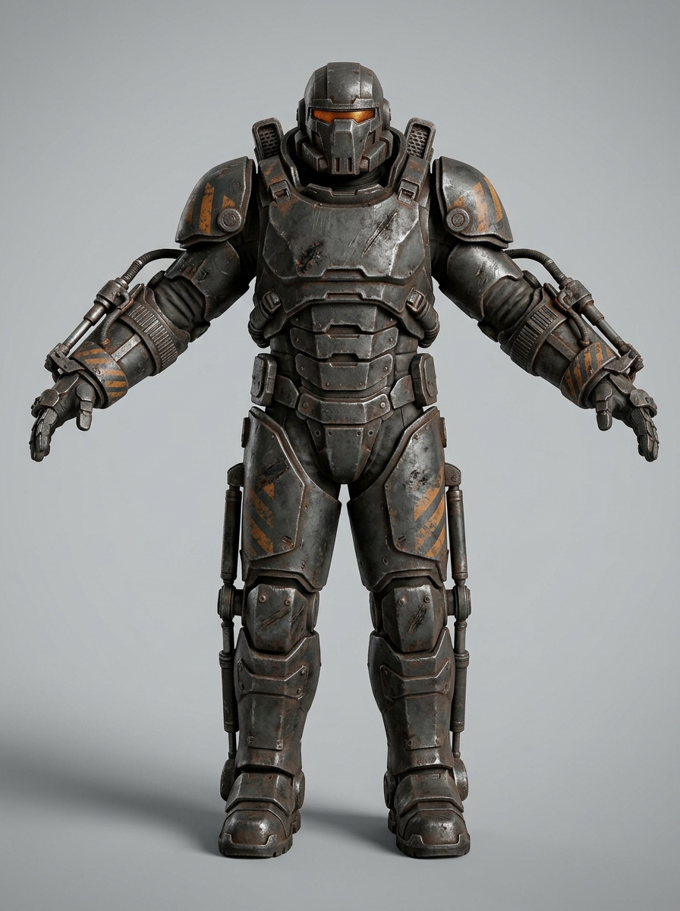

<p align="center">
  
</p>

<h1 align="center">Ashfall</h1>

<p align="center">
  <strong>A dark sci-fi action RPG in your browser.</strong><br>
  Fight through a ruined mining colony, build a hero and stop the Lumen before it reaches orbit.
</p>

<p align="center">
  <a href="https://github.com/felixarvid2/Ashfall/releases/latest"></a>
  
  
</p>

A year ago, the drills beneath the Ashfall colony broke through to something ancient. The Lumen spread through spores and machines, and the colony fell in three days. You are one of the few survivors who answered the distress signal.

**Ashfall** is an isometric action RPG inspired by the Diablo series: responsive combat, deep character builds, meaningful loot and a world that keeps getting harder. The entire game runs in the browser and also ships as an Android app for the AYN Thor and a desktop build for Ubuntu.

> **Status:** v1.5.0 is playable from the first zone through the endgame, but the game is still under active development. Feedback and bug reports are welcome in [Issues](https://github.com/felixarvid2/Ashfall/issues).

## Play

Download the build that fits your device from [Releases](https://github.com/felixarvid2/Ashfall/releases/latest):

- **Browser** – unzip `ashfall-vX.Y.Z-web.zip` and follow `HOW-TO-PLAY.txt`. The folder is served with any static web server.
- **AYN Thor** – install `ashfall-vX.Y.Z-thor.apk` and allow installs from unknown sources.
- **Ubuntu / Debian** – install `ashfall-vX.Y.Z-ubuntu-amd64.deb`.

## Four ways to survive

| Class | Playstyle | Resource |
|---|---|---|
| **Bastion** | Heavy exosuit melee. Stand in the fight and hit back harder. | Heat |
| **Spectre** | Mobile ranged fighter with rifles, traps and precision. | Focus |
| **Xenomant** | Biologist who turned the Lumen into a weapon. Summons and damage over time. | Biomass |
| **Lightbearer** | Support priest with light, shields and healing that still burns the corrupted. | Devotion |

Each class has its own skill tree, resource, gear and builds. After level 50, the **Neural Matrix** opens a larger progression board with glyphs and multiple connected grids.

## What's inside

- **Five regions** – Cinder Flats, the Refinery District, the Hydroponic Vaults, the Deep Mines and the Core, with hubs, dungeons, strongholds, quests and world events.
- **Loot worth chasing** – six rarities, aspects, unique items, sockets, crafting, tempering and masterworking.
- **Endgame** – World Tiers, Deep Rifts, world bosses, the Ash Harvest event and a level 1–100 rift climb.
- **Combat with weight** – hit-stop, screen shake, damage numbers, telegraphed boss attacks and dodge timing.
- **Play your way** – keyboard and mouse, gamepad, or the AYN Thor's built-in controls and second screen.
- **Quality of life** – loot filter, stash search, compare-on-hover, quest pinning, minimap zoom, photo mode and UI scaling.

## Controls

| Action | Input |
|---|---|
| Move | `WASD` or click |
| Primary / secondary skill | Left / right mouse button |
| Skills 1–4 | `1` `2` `3` `4` |
| Healing potion | `Q` |
| Dodge | `Space` |
| Map / quest log | `M` / `J` |
| Photo mode | `F8` |
| Menu | `Esc` |

Gamepad controls are supported. All bindings can be changed in the options.

## Development

<details>
<summary>Build and run from source</summary>

Requires Node.js and npm.

```bash
npm install
npm run dev       # development server
npm run build     # type check and production build
npm test          # unit tests
```

The design brief is in [docs/design-brief.md](docs/design-brief.md), the current state in [PROGRESS.md](PROGRESS.md), and the technical decisions in [docs/decisions.md](docs/decisions.md). Platform notes are in [docs/android.md](docs/android.md) and [docs/linux.md](docs/linux.md).

</details>

## Credits

Ashfall is an original project built with TypeScript, Three.js and Vite. 3D assets were generated with Meshy AI, and the project uses CC0 models, textures and audio from Kenney, Quaternius and other creators. Full credits and asset licenses are in [docs/credits.md](docs/credits.md).
